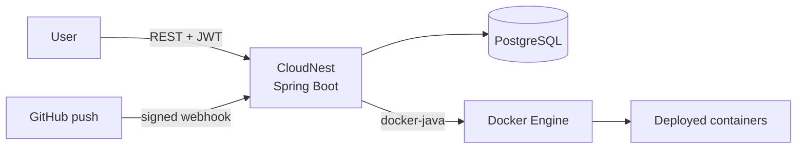

# CloudNest

A mini Platform-as-a-Service built with Spring Boot and Docker for deploying and managing containerized applications, with automatic redeployment on GitHub push.

## Features

- JWT authentication (register and login), with per-user ownership of deployments
- Create, start, stop, delete and inspect Docker container deployments through a REST API
- Deploy from a public Docker image or build directly from a GitHub repository with a `Dockerfile`
- GitHub webhook integration with HMAC SHA-256 signature verification
- Automatic rebuild and redeploy on every push to `main`, including several deployments per repository
- Scheduled `START` and `STOP` actions for deployments
- Container logs, image management and status reconciliation between the database and Docker

## Architecture



**For the full design** (layers, data model, deployment lifecycle, sequence diagrams, security and known limitations), see **[docs/architecture.md](docs/architecture.md)**.

## Tech stack

Java 17, Spring Boot, Spring Security (OAuth2 resource server, JWT), Spring Data JPA / Hibernate, PostgreSQL, Docker (docker-java), JGit, ngrok (local webhook testing)

## API overview

| Method | Endpoint | Auth | Description |
|---|---|---|---|
| POST | `/users` | No | Register |
| POST | `/auth/login` | No | Log in and receive a JWT |
| POST | `/deployments` | Yes | Create a deployment from an image or repository |
| GET | `/deployments`, `/deployments/{id}` | Yes | List or get deployments |
| POST | `/deployments/{id}/start`, `/stop` | Yes | Start or stop a deployment |
| GET | `/deployments/{id}/logs` | Yes | Container logs |
| PUT | `/deployments/{id}/refresh` | Yes | Sync status with Docker |
| DELETE | `/deployments/{id}` | Yes | Delete a deployment |
| POST / GET / DELETE | `/deployments/{id}/schedules` | Yes | Manage scheduled start/stop |
| GET / DELETE | `/images` | Yes | List and delete images |
| POST | `/webhooks/github` | Signature | GitHub push webhook |

Send the token as `Authorization: Bearer <token>`.

## Getting started

**Requirements:** Java 17, PostgreSQL, Docker (currently configured for Docker Desktop on Windows), Maven wrapper included.

1. Create a PostgreSQL database named `cloudnest`.
2. Set the values that are left blank in `src/main/resources/application.yaml`, or provide them as environment variables:
   - `spring.datasource.password` (`SPRING_DATASOURCE_PASSWORD`)
   - `jwt.secret` (`JWT_SECRET`): a Base64-encoded 32-byte key, for example from `openssl rand -base64 32`
   - `GITHUB_WEBHOOK_SECRET`: the secret you configure in the GitHub webhook
3. Make sure Docker is running.
4. Start the app:
   ```bash
   ./mvnw spring-boot:run
   ```
   The API runs on `http://localhost:8080`.

Never commit real secrets.

### Try it

```bash
# register and log in
curl -X POST localhost:8080/users -H "Content-Type: application/json" \
  -d '{"name":"demo","email":"demo@example.com","password":"changeme"}'
curl -X POST localhost:8080/auth/login -H "Content-Type: application/json" \
  -d '{"email":"demo@example.com","password":"changeme"}'

# deploy nginx
curl -X POST localhost:8080/deployments \
  -H "Authorization: Bearer <token>" -H "Content-Type: application/json" \
  -d '{"name":"my-first-app","image":"nginx:latest","containerPort":80}'
```

### GitHub webhook (automatic redeploy)

1. Expose the app: `ngrok http 8080`.
2. In your GitHub repository, add a webhook with payload URL `https://<ngrok-url>/webhooks/github`, content type `application/json`, event **push**, and the same secret as `GITHUB_WEBHOOK_SECRET`.
3. Create a deployment with a `repositoryUrl`. Each push to `main` now rebuilds and redeploys it.

## Known limitations and roadmap

- Host port can change after a redeploy (stable ports in progress)
- Webhook processing is synchronous; asynchronous handling with per-deployment error isolation is planned
- HTTP health checks and explicit rollback to a previous version
- Docker connection is currently set for Docker Desktop on Windows
- Automated tests and a CI pipeline are being added

More detail in [docs/architecture.md](docs/architecture.md#10-known-limitations-and-planned-improvements).

## Author

Vo Huynh Minh Khang · [GitHub](https://github.com/kgnah)
