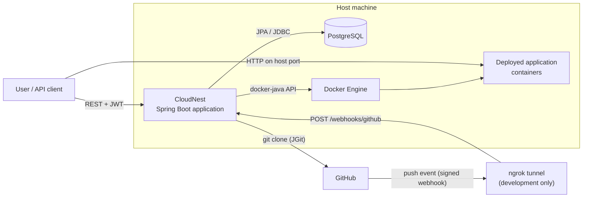
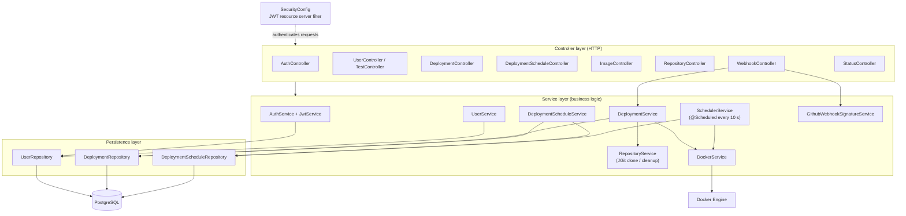
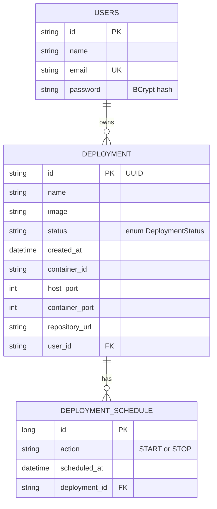
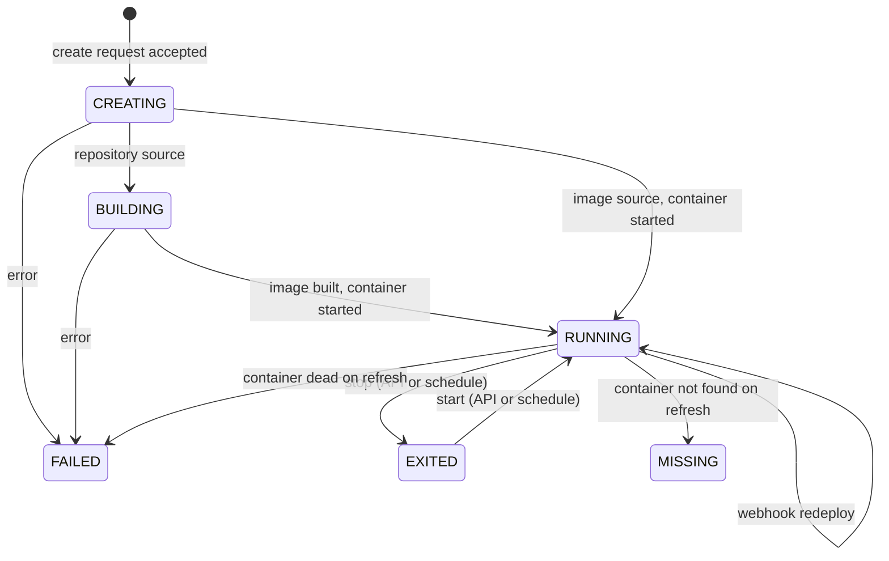
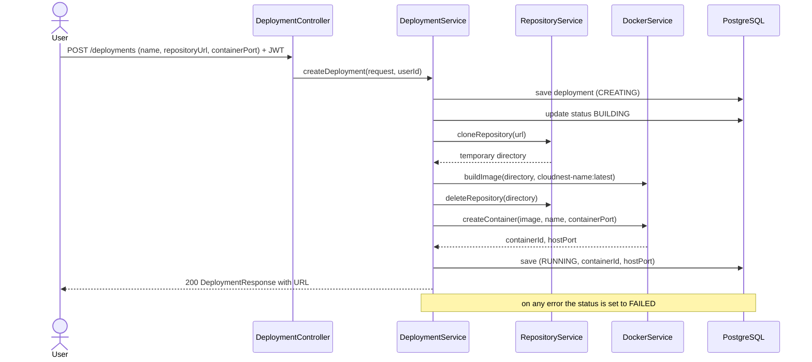
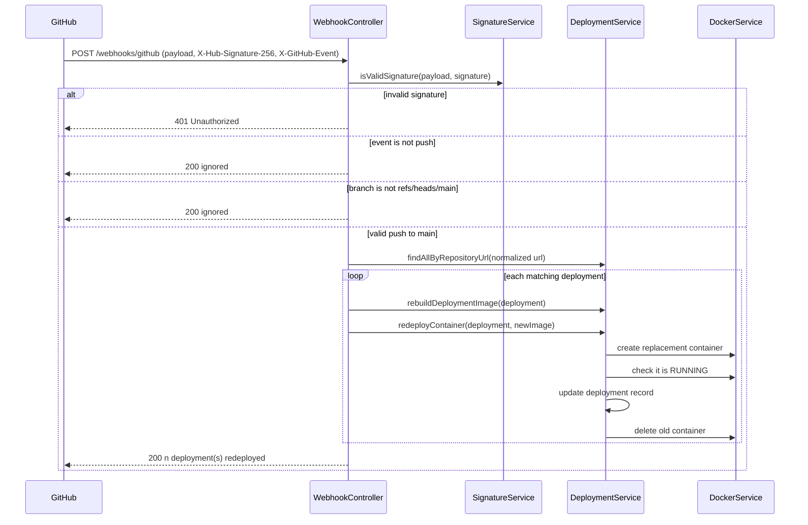
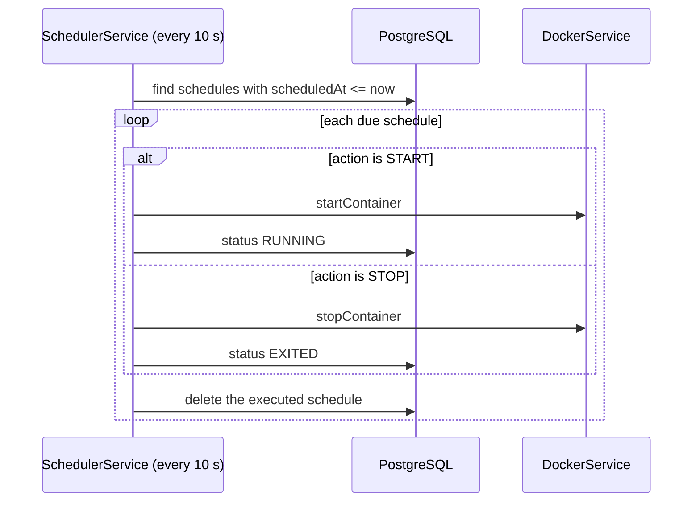

# CloudNest — System Architecture

| | |
|---|---|
| **Project** | CloudNest, a mini Platform-as-a-Service |
| **Author** | Vo Huynh Minh Khang |
| **Stack** | Java 17, Spring Boot, Spring Security (JWT), Spring Data JPA, PostgreSQL, Docker (docker-java), JGit |

## 1. Purpose and scope

CloudNest lets an authenticated user deploy and manage containerized applications through a REST API. A deployment is created from either:

- a **public Docker image** (pulled if not present locally), or
- a **Git repository** containing a `Dockerfile`, which CloudNest clones, builds into an image and runs.

When a deployment is linked to a GitHub repository, a signed GitHub webhook triggers an automatic rebuild and redeploy on every push to `main`. Users can also schedule `START` and `STOP` actions.

**In scope:** deployment lifecycle, image management, GitHub-driven redeployment, scheduled actions, user authentication.
**Out of scope (current version):** reverse proxy and custom domains, environment variables per deployment, multi-node orchestration, zero-downtime releases.

## 2. System context

| Actor / system | Role |
|---|---|
| User / API client | Registers, logs in, manages deployments and schedules |
| GitHub | Source of repositories; sends `push` webhooks |
| ngrok | Exposes the local application to GitHub during development |
| PostgreSQL | Persists users, deployments and schedules |
| Docker Engine | Builds images and runs the deployed containers |

## 3. Layered architecture

**Responsibilities**

| Layer | Component | Responsibility |
|---|---|---|
| Controller | `DeploymentController` | `POST/GET/DELETE /deployments`, start, stop, logs, refresh |
| Controller | `DeploymentScheduleController` | Create, list, delete schedules for a deployment |
| Controller | `ImageController` | List images, delete image, check whether an image is in use |
| Controller | `RepositoryController` | `POST /repositories/build`, build an image from a repository |
| Controller | `WebhookController` | `POST /webhooks/github`, verify, filter and trigger redeploy |
| Service | `DeploymentService` | Deployment lifecycle, rebuild, redeploy, repository matching |
| Service | `DockerService` | All Docker Engine calls (containers, images, logs, ports) |
| Service | `RepositoryService` | Clone to a temporary directory, delete with retries |
| Service | `SchedulerService` | Polls due schedules every 10 seconds and runs them |
| Service | `GithubWebhookSignatureService` | HMAC SHA-256 verification with constant-time comparison |
| Service | `JwtService` / `AuthService` | BCrypt password check, HS256 token issuing (1 hour expiry) |
| Persistence | Spring Data repositories | CRUD and query methods for the three entities |

Dependencies point downward only: controllers depend on services, services depend on repositories and `DockerService`. `DockerService` is the only class that talks to Docker, which keeps container logic in one place and easy to mock in tests.

## 4. Data model

Ownership is enforced at the service layer: deployment queries use `findByIdAndUserId`, so one user cannot read or modify another user's deployments.

## 5. Deployment lifecycle

The persisted status can drift from the real Docker state (for example, a container removed manually). `PUT /deployments/{id}/refresh` and the list/get endpoints reconcile the two, mapping a missing container to `MISSING` and Docker states to the `DeploymentStatus` enum.

## 6. Key flows

### 6.1 Create a deployment from a repository

The request must contain **either** an image **or** a repository URL, never both. The temporary clone is always deleted in a `finally` block.

### 6.2 Automatic redeploy on GitHub push

Design points:

- The signature is verified against the **raw** request body before any parsing.
- Repository URLs are normalized (trailing slash and `.git` removed) so GitHub's clone URL matches the stored URL.
- One repository can back **several** deployments, so the webhook redeploys all matches.
- The replacement container is started and checked **before** the old one is removed. If the replacement fails, it is deleted and the old deployment record is left unchanged.

### 6.3 Scheduled actions

## 7. Security design

| Concern | Approach |
|---|---|
| Authentication | Stateless JWT (HS256), 1 hour expiry; Spring Security OAuth2 resource server validates the token on every request |
| Public endpoints | Only `POST /users` (register), `POST /auth/login` and `POST /webhooks/github`; everything else requires a valid token |
| Passwords | Stored as BCrypt hashes; never returned in responses (`UserResponse` omits them) |
| Authorization | Per-user ownership check on every deployment and schedule operation |
| Webhook authenticity | HMAC SHA-256 over the raw body using a shared secret, compared in constant time (`MessageDigest.isEqual`); invalid requests get 401 |
| Secrets | Database password, JWT key and webhook secret come from configuration or environment variables, never from source control |
| CSRF | Disabled, because the API is stateless and uses bearer tokens rather than cookies |

## 8. Configuration

| Property | Purpose |
|---|---|
| `spring.datasource.*` | PostgreSQL connection |
| `jwt.secret` | Base64-encoded 32-byte HMAC key for signing tokens |
| `GITHUB_WEBHOOK_SECRET` | Shared secret configured in the GitHub webhook |
| `cloudnest.base-url` | Base for the deployment URL returned to users (`base-url:hostPort`) |

## 9. Key design decisions

| Decision | Reason |
|---|---|
| Single `DockerService` wrapper | One place for all Docker calls; simple to test and replace |
| Persist status in the database and reconcile with Docker | The platform must survive restarts and still report state when a container disappears |
| Replacement-before-removal during redeploy | A failed build or start does not take down the working version |
| Layered package structure (`controller`, `service`, `repository`, `entity`, `dto`) | Clear separation of HTTP, logic and persistence |
| Webhook matches by repository URL, not deployment ID | GitHub identifies repositories, not CloudNest deployments |
| Temporary clone directory deleted in `finally` with retries | Avoids disk leaks, including on Windows file-lock delays |

## 10. Known limitations and planned improvements

| Area | Current behavior | Planned improvement |
|---|---|---|
| Host port stability | A redeployed container receives a newly chosen host port | Reuse the original port (stop old container first) or add a reverse proxy so URLs stay stable |
| Webhook processing | Rebuild and redeploy run synchronously inside the HTTP request, and one failing deployment stops the loop | Process asynchronously, isolate failures per deployment and return a success/failure summary |
| Health checks | A container counts as healthy when Docker reports `RUNNING` | Add an HTTP health check before switching over |
| Rollback | Failed replacement keeps the old record | Keep deployment history and versioned releases for explicit rollback |
| Scheduler | Runs inside the application and a failing action is retried every cycle | Per-schedule error handling and a failed state |
| Docker connection | The Docker host is set to the Windows Docker Desktop named pipe | Use the default Docker configuration so `DOCKER_HOST` and non-Windows hosts work |
| Observability | Console output | Structured logging and metrics |
| Database schema | Hibernate `ddl-auto: update` | Flyway or Liquibase migrations |
| Testing | Context-load test only | Unit tests for signature, URL matching and status mapping; MockMvc tests for the webhook; CI pipeline |
